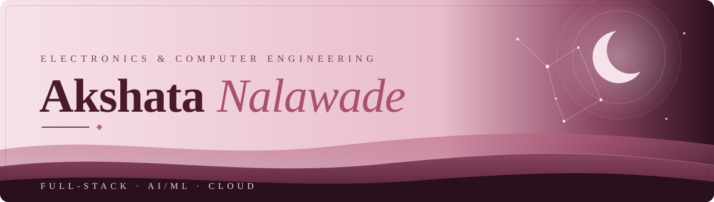
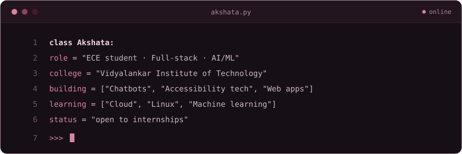
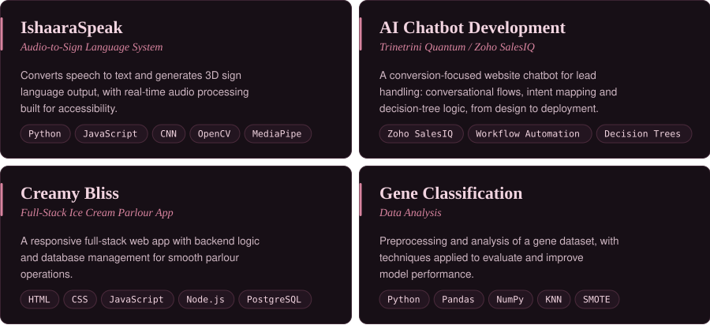
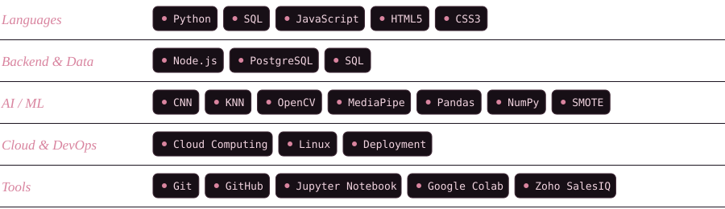

*Mumbai, India*

## About Me

I'm an **Electronics & Computer Science engineering student** at Vidyalankar Institute of Technology (B.Tech, 2023–2027) who builds across full-stack web, AI, and cloud. I like turning messy real-world workflows into systems that run on their own: chatbots, accessibility tools, and data pipelines.

## Featured Projects

## Tech Stack

## GitHub Activity

## Training & Certifications

| Program | Where | When |
|:--|:--|:--|
| AI Chatbot Development Internship | Trinetrini Quantum | 1 Dec – 15 Jan |
| Certificate Course in Cloud Computing (60 hrs: Cloud, Linux, deployment) | C-DAC ACTS, Pune | 5 – 15 June |
| Fundamentals of Machine Learning | [Infosys Springboard](https://infyspringboard.onwingspan.com/web/en/app/toc/lex_auth_0130944347611955202379_shared/overview) | Completed |

## Beyond Code

Away from the keyboard, I'm learning in public: picking up cloud and ML fundamentals alongside coursework, and looking for problems where automation actually saves someone time.

## Let's Connect

Open to internships, collaborations, and conversations about AI, cloud, and accessibility.
**akshata.nalawade@vit.edu.in** · [GitHub](https://github.com/nalawadeakshata29) · [LinkedIn](#)

