 

## 🌸 About Me

I'm an **Electronics & Computer Science engineering student** at Vidyalankar Institute of Technology who loves mixing a little of everything: full-stack web, AI, cloud, and problem-solving that actually helps people.

✨ a little more about me

 

- 🧪 Currently brewing: **IshaaraSpeak**, a speech-to-sign-language system with 3D output
- 🤖 Built a conversion-focused **AI chatbot** with Zoho SalesIQ during my internship at Trinetrini Quantum
- ☁️ Completed **Cloud Computing & Linux** training at C-DAC ACTS, Pune
- 🌱 Learning: Linux & Cloud · Git collaboration · CI/CD pipelines · System design basics · YAML
- 💜 Fast learner, team player, endlessly curious

## 🚪 The Archway (Tech Stack)

## 💌 Postcards from My Projects

Want to see the code? Peek into my <a href="https://github.com/nalawadeakshata29?tab=repositories">repositories</a> 🌷

## 🌳 My Little Garden (GitHub Stats)

<table>
<tr>
<td width="42%" valign="top" align="center">

</td>
<td width="58%" valign="middle" align="center">

</td>
</tr>
</table>

## 🗺️ My Learning Path

## 🕯️ Training & Certifications

| Course | Where | When |
|---|---|---|
| AI Chatbot Development Internship | Trinetrini Quantum | 1 Dec – 15 Jan |
| Cloud Computing, Linux & Deployment (60 hrs) | C-DAC ACTS, Pune | 5 – 15 June |
| Fundamentals of Machine Learning | Infosys Springboard | Completed |

 

